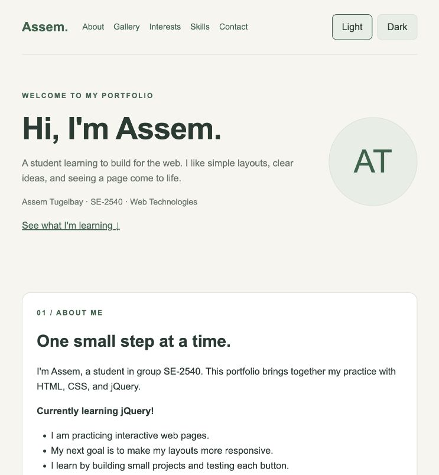
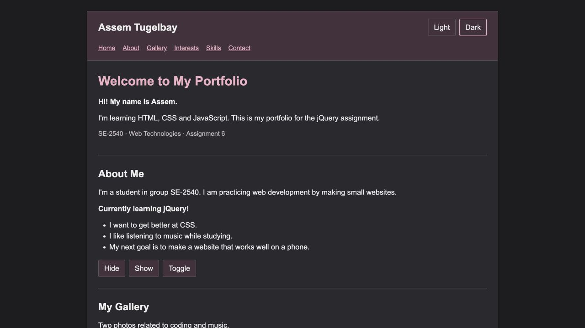
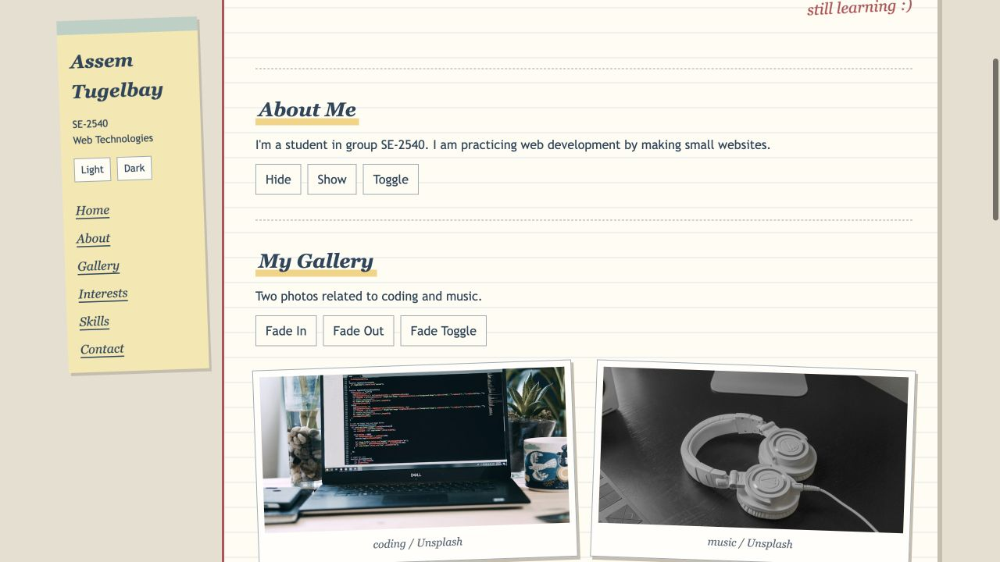
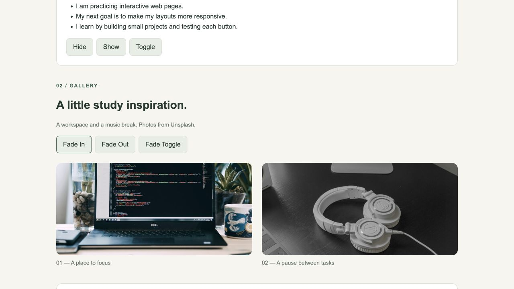
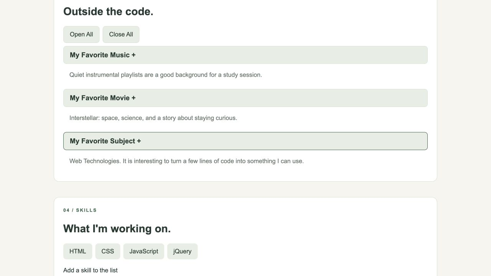
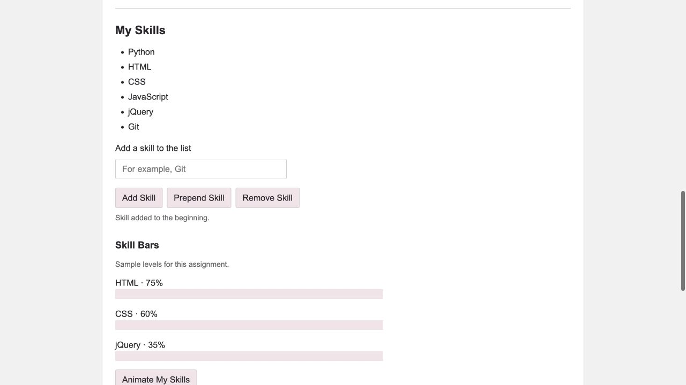
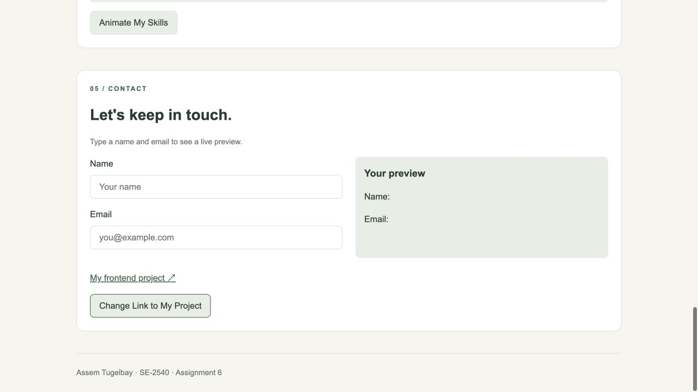
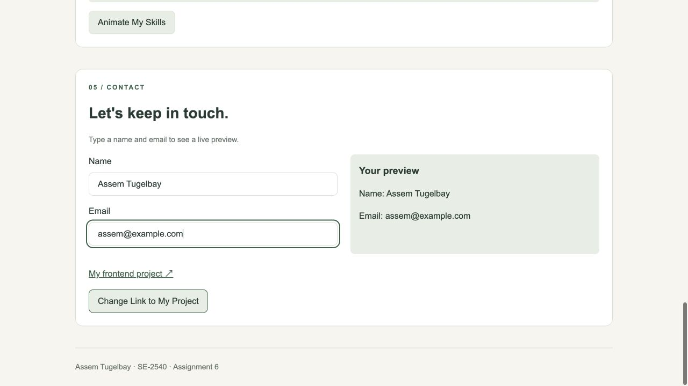
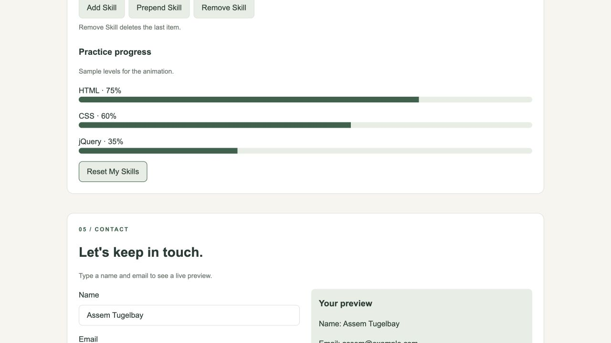

# Assignment 6 — jQuery Portfolio

**Name:** Assem Tugelbay  
**Group:** SE-2540

**Website:** [Open my portfolio](https://asemtygelbaeva-byte.github.io/assignment6_frontend/)

A small portfolio made with HTML, CSS, and jQuery. The page includes information about me, a gallery, interests, a skill list, and a live form preview.

## Part 1. Getting Started with jQuery

### Task 0. Setup

jQuery 3.7.1 is loaded from the official CDN. All handlers are inside `$(document).ready(function () { ... })`. The browser console prints `jQuery is ready!` when the page loads.

### Task 1. Selectors and CSS

The page shows my name, group, headline, and introduction. `#greeting` is an ID selector, `h1` is a tag selector, and `.intro` is a class selector. `.text()` updates the greeting. `.css()` changes the heading color and makes the introduction bold. Light and Dark buttons switch the theme. Common colors and spacing are stored in CSS variables.

## Part 2. jQuery Effects

### Task 2. Visibility Methods

About Me contains a short biography, the status “Currently learning jQuery!”, and three facts or goals. Hide, Show, and Toggle control the extra information using `.hide()`, `.show()`, and `.toggle()`. The screenshot shows the hidden state.

### Task 3. Fade Methods

The gallery has two photos: a workspace and a music setup. Fade In, Fade Out, and Fade Toggle use `.fadeIn(500)`, `.fadeOut(500)`, and `.fadeToggle(500)` on both images. The image frames keep their size when the photos disappear.

### Task 4. Slide Methods

Three clickable headings open information about music, a movie, and a subject. Each heading uses `.slideToggle(300)` for its own panel. Open All uses `.slideDown(300)`, and Close All uses `.slideUp(300)`.

## Part 3. DOM Manipulation with jQuery

### Task 5. Add and Remove Elements

The initial list has HTML, CSS, JavaScript, and jQuery. Add Skill puts a new item at the end with `.append()`. Prepend Skill puts it at the beginning with `.prepend()`. Remove Skill deletes the last item with `.remove()`. Empty input and spaces are rejected. New list items are filled with `.text()`.

The screenshot shows Python added at the beginning and Git at the end.

### Task 6. Modifying Attributes

The social link initially opens my GitHub profile. Change Link to My Project changes its `href` to this assignment repository using `.attr()` and updates the link text.

### Task 7. Form Interaction

The form contains Name and Email inputs. On each `input` event, `.val()` reads both values and `.text()` displays them in the preview. The form is a local demonstration and does not send messages.

## Part 4. Animations

### Task 8. Basic Animation

The three skill bars start at zero width. Animate My Skills uses `.animate()` to fill HTML to 75%, CSS to 60%, and jQuery to 35% over 800 ms. These are sample values for the animation. Clicking the same button again returns all bars to zero.

## Work Process

I started with the HTML sections, then added the layout and the two themes. After that, I connected each button to a short jQuery handler. I checked the visibility, fade and slide effects, empty skill input, list order, link destination, live preview, and both directions of the bar animation. The console message appeared without JavaScript errors.

## Files and Running

- `index.html` — the HTML, CSS, and jQuery handlers.
- `assets/` — the two gallery photos.
- `screenshots/` — screenshots for Tasks 0–8.
- `README.md` — this report.

Open the website link above, or open `index.html` in a browser. An internet connection is needed for the jQuery CDN. Changes to the list and form reset when the page reloads.

## Sources

- [Official jQuery CDN](https://releases.jquery.com/) and [jQuery API](https://api.jquery.com/).
- Workspace photo: [Unsplash](https://unsplash.com/photos/a-laptop-computer-sitting-on-top-of-a-desk-5NM32v14n6M).
- Music photo: [Andres Jasso on Unsplash](https://unsplash.com/photos/white-and-black-headphones-on-black-table-jfwtA-Mt9uc).
